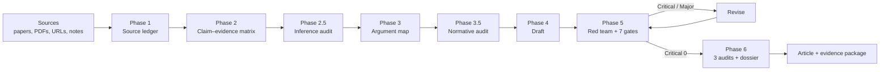

# Architecture

This is not a monolithic “write me an article” prompt. It is a small protocol
with explicit state, phase gates, and a fallback for hosts that cannot run the
full workflow.



## 1. Design goals

| Goal | Consequence |
|---|---|
| Work with any AI | The core is plain Markdown, no vendor API required. |
| Degrade honestly | Missing capabilities have named fallbacks, not fake claims. |
| Make reasoning inspectable | Sources, claims, warrants, inference types, and objections are written down. |
| Resist sycophancy | The user's preferred conclusion is not evidence. |
| Resist citation theater | Every factual claim needs a source ID or `【未確認】`. |
| Separate fact, inference, value, and prose | A higher layer cannot override a lower one. |
| Be auditable | Three deterministic scripts check structure where possible. |
| Be consistent | Rule, phase, and role identifiers are cross-checked by `scripts/check_consistency.py` in CI, not only by review. |
| Stay small | Four engines plus a Japanese editing layer, seven gates, six red-team roles; not an org chart. |

## 2. The state model

The protocol externalizes four kinds of state:

| Artifact | Question it answers | Key fields |
|---|---|---|
| `sources.csv` | What did we read, and how well? | `id`, `type`, `title`, `authors`, `year`, `doi`, `url`, `verification`, `relevance`, `locator` |
| `claims.csv` | What are we asserting, and on what basis? | `claim_id`, `claim`, `claim_type`, `evidence_ids`, `warrant`, `confidence`, `counterevidence`, `status`, `load_bearing`, `falsifier` |
| `argument-map.md` | Why does the evidence support the thesis? | claim, grounds, warrant, backing, qualifier, rebuttal |
| `logic-report.md` | What kind of inference is this, and where could it fail? | conclusion, premises, inference type, counterexample, falsifier |
| `dossier.md` | What should a skeptical reader know? | thesis, confidence, strongest objection, limits, unresolved questions, value premises, AI disclosure |

The separation matters. A source can support several claims; a claim can need
several sources. Collapsing them into one bibliography hides that structure.

### Source verification states

```text
verified
partial
abstract-only
secondary-only
unverified
retracted
```

A `retracted` source is not “weak evidence”; it is a Critical problem if used as
support. `abstract-only` cannot support a claim about the full text's method or
limitations.

### Claim types

```text
descriptive | causal | predictive | mechanistic | evaluative
interpretive | conceptual | policy
```

The type determines what evidence is sufficient. A cross-sectional correlation
can support a descriptive association; it cannot, by itself, support a causal
claim. The protocol forces this distinction into the ledger instead of leaving
it to prose.

## 2.1 Four engines and a Japanese layer

| Engine | File | Role |
|---|---|---|
| Logic | `references/logic-and-inference.md` | Standard form, deduction, induction, causation, probability, ACH, fallacy repair |
| Synthesis | `references/knowledge-synthesis.md` | Multi-document reading, evidence independence, PRISMA, meta-analysis, disagreement |
| Normative | `references/normative-and-conceptual.md` | Value premises, ethical frameworks, policy, conceptual analysis, culture |
| Orchestration | `references/orchestration.md` | Roles, handoffs, parallel reading, long context, stop rules |
| Japanese | `references/japanese-editing.md` | Subject–predicate alignment, metaphor, anthropomorphism, no invented facts, sentence length and commas |

The engines are layered: evidence → inference → values → prose. A higher layer
cannot change the lower layer's facts, citations, or uncertainty.

## 3. Phases and gates

| Phase | Output | Gate |
|---|---|---|
| 0. Intake | brief | question, reader, mode, source scope are explicit |
| 1. Collect | `sources.csv`, `search-log.md` | load-bearing claims have evidence; at least one counter-source was read; evidence independence checked |
| 2. Appraise | `claims.csv`, `contradictions.md` | every claim has evidence or `low` confidence; weak evidence is not described as strong |
| 2.5 Inference | `logic-report.md` | every load-bearing claim has an inference type, warrant, counterexample check, and falsifier |
| 3. Design | `argument-map.md`, `outline.md` | one-sentence thesis; strongest objection; every section has a job; value premises explicit |
| 3.5 Normative (conditional) | value-premise note in `dossier.md` | required only for `normative` / `policy` or any normative claim: one-sentence value premise, two frameworks, distribution, worst-off, opposing value, abuse risk / resource allocation / religious and cultural views where relevant, exit condition |
| 4. Draft | `article-draft.md` | every paragraph has a function; uncertainty is visible |
| 5. Red team | `review-report.md`, `logic-report.md`, `revision-log.md` | Critical = 0; Major fixed or explicitly acknowledged; G1–G7 pass |
| 6. Deliver | `article.md`, `dossier.md`, 3 audit JSONs | audits pass, or a named manual fallback |

**Critical is not averaged away.** A citation fabrication is Critical even if the
prose is excellent. This is the main difference between a quality checklist and
a quality gate.

## 4. The six red-team roles

| Role | Question | Typical finding |
|---|---|---|
| **Empiricist** | Does the evidence actually measure what the claim says? | “The outcome is self-reported productivity, not output.” |
| **Logician** | Is the inference valid? What is hidden? | “The argument assumes remote work caused the retention difference.” |
| **Contrarian** | What is the strongest opposing case? | “The effect may be selection, not treatment.” |
| **Normative analyst** | Whose values and burdens are at stake? | “The policy assumes workers can absorb the transition cost.” |
| **Practitioner** | Would this work in the real setting? | “The intervention requires manager training the article never mentions.” |
| **Reader** | Can a smart non-expert follow it? | “The term ‘coordination density’ is used before it is defined.” |

If subagents are unavailable, one model plays all six roles sequentially with
separate headings. That is weaker than independent reviewers, and the protocol
says so: the six roles are a **coverage** claim about different error types, not
an **independence** claim about six separate checks. A shared blind spot is not
removed by re-prompting the same model. See
[`design-notes.md`](design-notes.md) §2 for the model and its limits.

Structural errors (missing citation IDs, ledger mismatches, bibliography form,
digit errors) are therefore pushed into the deterministic scripts rather than
into another role.

## 5. Concession Threshold

When an objection arrives, rate its strength from 1 to 5. The score must be a
function of **observable predicates**, not of how persuasive the objection
feels. Score it in a pass separate from drafting, and record which predicate
was satisfied.

| Score | Observable condition | Response |
|---|---|---|
| 5 | Conceding the objection entails the negation of the thesis; no repair is available | Change the thesis. |
| 4 | The objection falsifies a load-bearing premise, and no evidence in the article restores it | Revise the argument and disclose it. |
| 3 | A term, scope, or qualifier is ambiguous; the thesis survives clarification | Clarify, but do not reverse the thesis. |
| 2 | An example, citation format, or emphasis is wrong; thesis and premises are unaffected | Acknowledge or fix locally. |
| 1 | The objection misreads the text (attributes a claim that was not made) | Explain, without conceding. |

The point is to prevent two failure modes: stubbornness and endless appeasement.
The score is not a measure of the objector's confidence or status. Self-scoring
by the drafting model remains biased; the rubric reduces arbitrariness, not
bias.

## 6. Capability adaptation

| Capability | Full path | Fallback |
|---|---|---|
| File read/write | CSV/Markdown artifacts | Inline tables in the chat response |
| Web search | Primary sources with URLs and access dates | Ask for sources; do not pretend to search |
| PDF/image reading | Full text, page numbers, figures | Ask for text; mark as `abstract-only` |
| Code execution | Run `audit_article.py`, `argument_lint.py`, `verify_sources.py` | Manual checklist; state “machine audit not run” |
| Subagents | Independent roles (reader through auditor) | Sequential role-play in one response |
| Long context | Read full documents | Chunk, summarize, record page ranges, disclose unread parts |

The rule is simple: **never claim a capability you did not use.** A confident
fake is worse than an honest gap.

## 7. Prompt generation

`SKILL.md` is the single source of truth. `scripts/build_universal.py` strips the
YAML frontmatter and adds a host-neutral header to produce
`UNIVERSAL-PROMPT.md`.

```text
SKILL.md ──build_universal.py──> UNIVERSAL-PROMPT.md
   │
   ├── used directly by Agent Skills hosts
   ├── condensed into UNIVERSAL-PROMPT-LITE.md for small contexts
   └── adapted by AGENTS.md and adapters/*.md
```

`--check` fails if the generated file is stale. CI enforces this so the portable
prompt cannot silently drift from the skill.

`SKILL.md` is also the canonical source for **identifiers**: rule IDs
(`R01–R15`), phase numbers, mode names, red-team roles, and forbidden-pattern
IDs. `scripts/check_consistency.py` parses those identifiers from `SKILL.md`
and compares them with `docs/architecture.md`, `references/orchestration.md`,
`UNIVERSAL-PROMPT-LITE.md`, the README files, and `evals/evals.json`. The point
is not stylistic uniformity: a phase that exists in a diagram but not in the
protocol is a claim the model cannot follow, and a role count that differs
between files is a defect that survives review. See
[`design-notes.md`](design-notes.md) §3 for what the check can and cannot
guarantee.

## 8. The three audit scripts

### 8.1 `audit_article.py`

- extracts `[S01]`, `[S01: p.12]`, `[S01; S04]` markers
- checks that cited IDs exist in `sources.csv`
- flags retracted, unverified, and abstract-only sources used as support
- checks claim-evidence links and load-bearing claims without evidence
- flags normative claims without a warrant, causal claims backed only by
  cross-sectional evidence, and duplicate DOIs
- flags direct quotations without a locator
- flags unresolved `【未確認】`, `TODO`, `TBD`
- flags overclaiming and a small set of AI-slop phrases
- emits a JSON report with `READY`, `CONDITIONAL`, or `NOT READY`

### 8.2 `argument_lint.py`

- detects correlational language paired with causal claims when no causal design
  is mentioned
- flags non-significance presented as “no effect”
- flags anecdote-to-universal generalization, false dilemmas, appeals to
  authority without citations, ad hominem, slippery slopes, is-ought leaps,
  survivorship reasoning, and base-rate neglect
- checks claims for a normative warrant, a falsifier, counterevidence, and
  high confidence attached to contested or unverified claims
- checks causal claims against cross-sectional evidence descriptions
- emits `PASS`, `PASS_WITH_NOTES`, `REVIEW`, or `FAIL`

### 8.3 `verify_sources.py`

- checks CSV headers, IDs, duplicates, year and access-date formats
- validates DOI form, URL form, arXiv IDs, and ISBN check digits
- detects duplicate DOIs, URLs, and titles
- checks the article for missing or retracted sources
- with `--online`, resolves DOIs/URLs and reports reachability, without failing
  on network errors
- emits `PASS`, `PASS_WITH_NOTES`, `REVIEW`, or `FAIL`

None of the three verifies bibliographic existence, semantic support,
statistical validity, or argument strength. Those remain human work.

### 8.4 `check_consistency.py`

- compares the canonical identifier sets in `SKILL.md` with
  `docs/architecture.md`, `references/orchestration.md`, and
  `UNIVERSAL-PROMPT-LITE.md`: phases, roles, modes, rule IDs, and forbidden
  patterns
- checks that every reference and asset named in `SKILL.md` exists, and that
  every file in `references/` is named
- checks that the documented behavioral-case count matches
  `evals/evals.json`, that phase 3.5 is not a diagram-only artifact, and that
  the `SKILL.md` size claim in `references/skill-stack.md` is true
- runs `build_universal.py --check` so the portable prompt cannot drift
- exits 0 when every relation holds, 1 otherwise

It checks **relations between artifacts**, not the truth of their content. A
green run means the documents agree with each other, not that the protocol is
correct.

Exit codes:

| Code | Meaning |
|---|---|
| 0 | READY / PASS / CONDITIONAL / PASS_WITH_NOTES / consistency pass |
| 1 | consistency failure (a relation between artifacts is broken) |
| 2 | NOT READY / REVIEW / FAIL (Critical, or Major under `--strict` / `--fail-on`) |
| 3 | Input error |

## 9. Why not a fully autonomous pipeline?

Because the failure modes that matter most are judgment calls:

- Is this source actually about the same population?
- Does the quotation mean what the article says it means?
- Is the strongest objection strong enough?
- Is the conclusion appropriately modest?

Automating those judgments without a human gate would reproduce the problem the
protocol is meant to catch. The design keeps the model fast at drafting and
checking structure, and keeps the human responsible for meaning.
